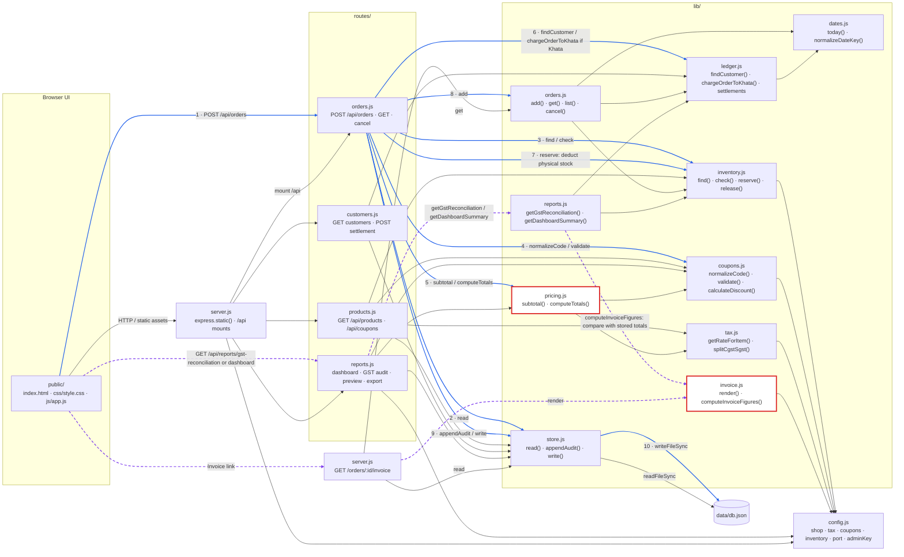

# ShopLedger architecture

Legend:
1. Numbered blue arrows trace place-order execution; steps 3 and 7 call the same inventory module.
2. Purple dashed arrows trace the separate printable invoice and GST audit paths.
3. Other arrows show supporting calls, configuration reads, static serving and database reads; responses are omitted.
4. Ticket 1 hotspot: two engines compute the same GST
5. Khata charging is conditional; mutations stay in memory until store.write() replaces data/db.json; audit compares stored totals without calling pricing.computeTotals().
